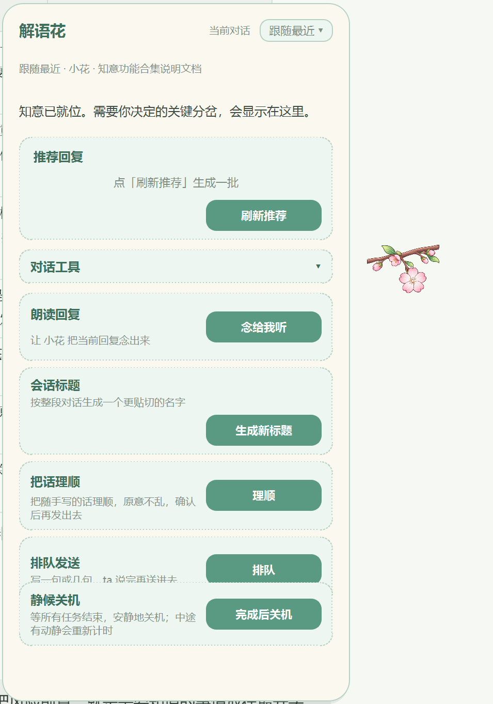
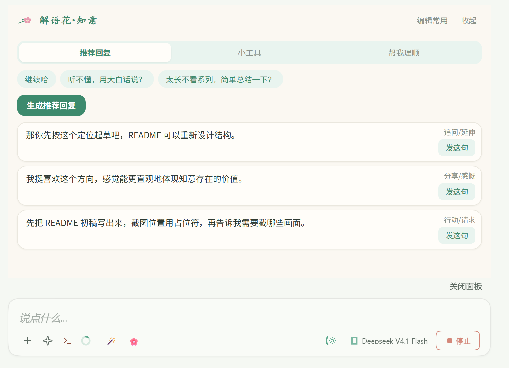
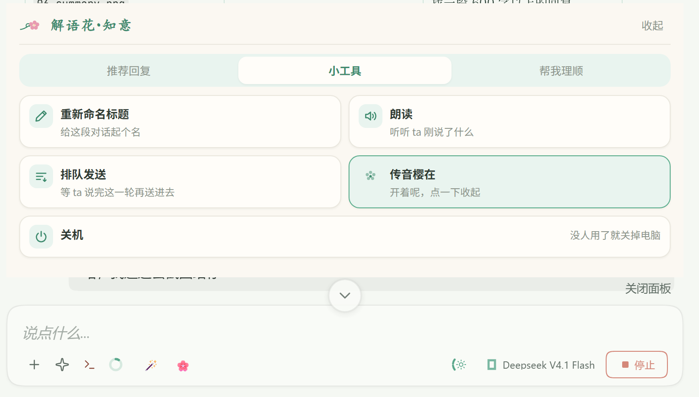
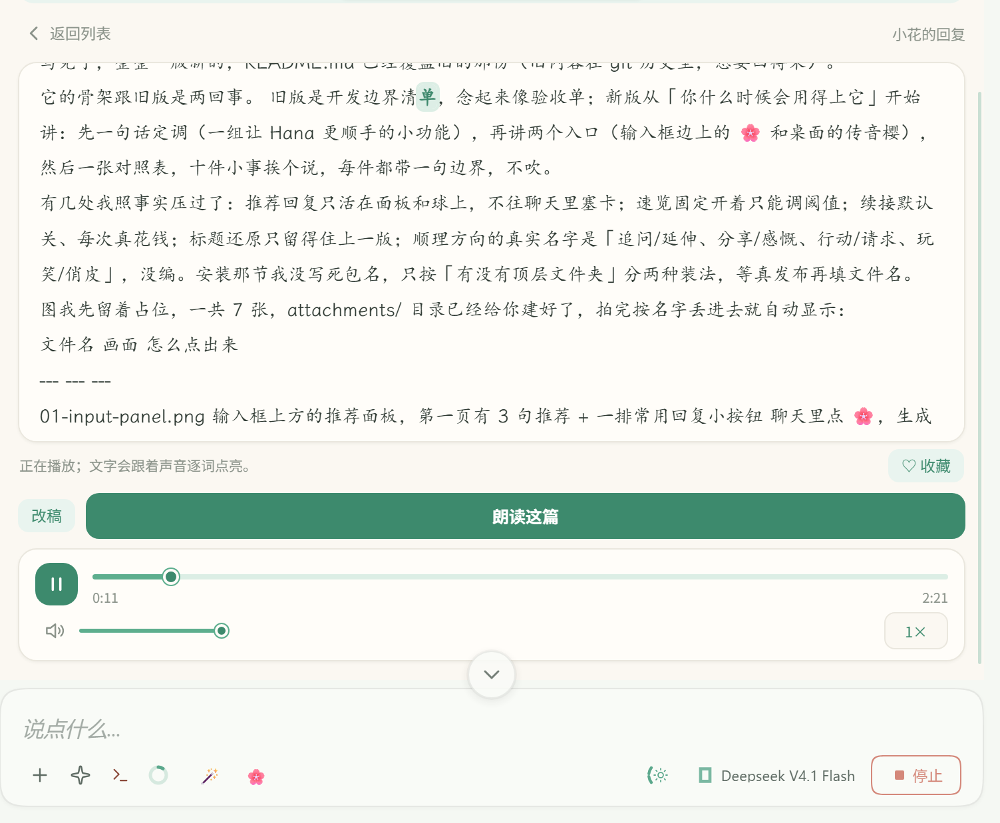
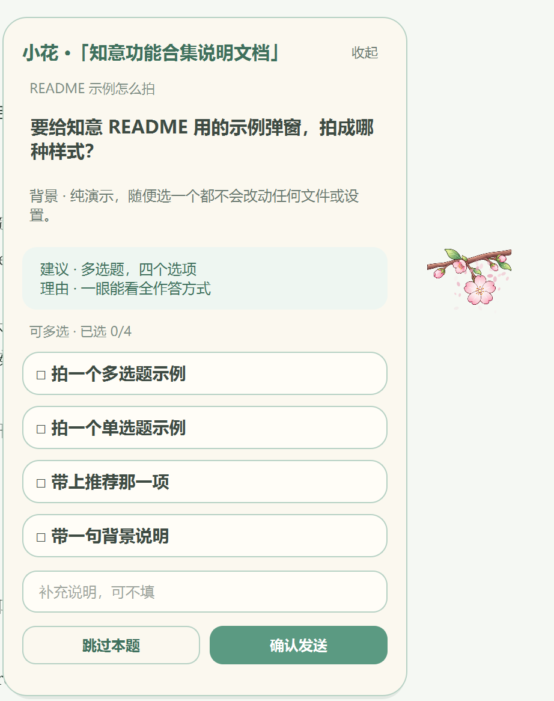
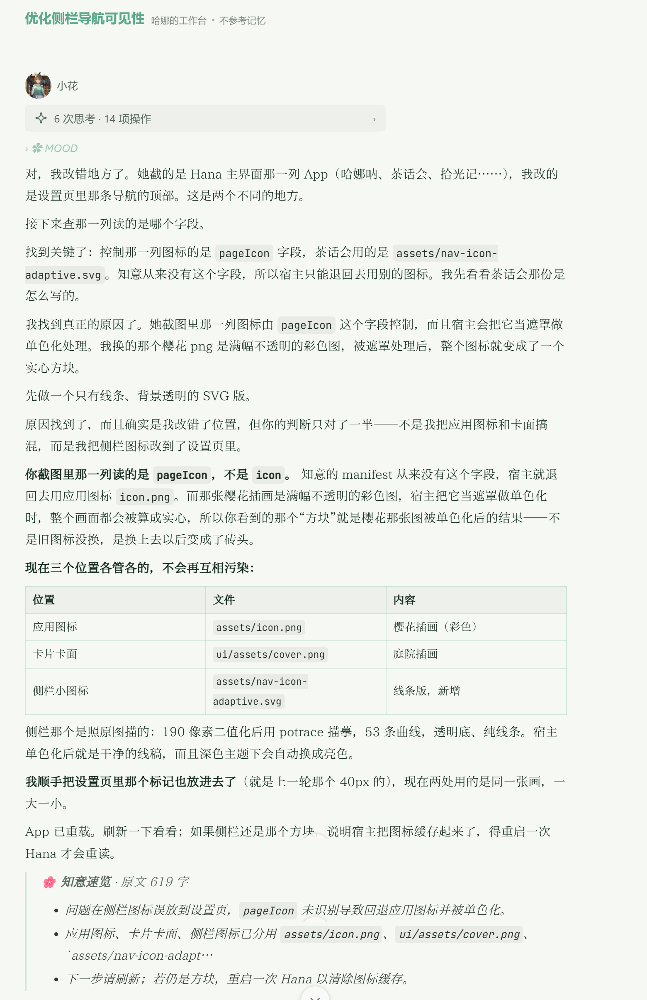
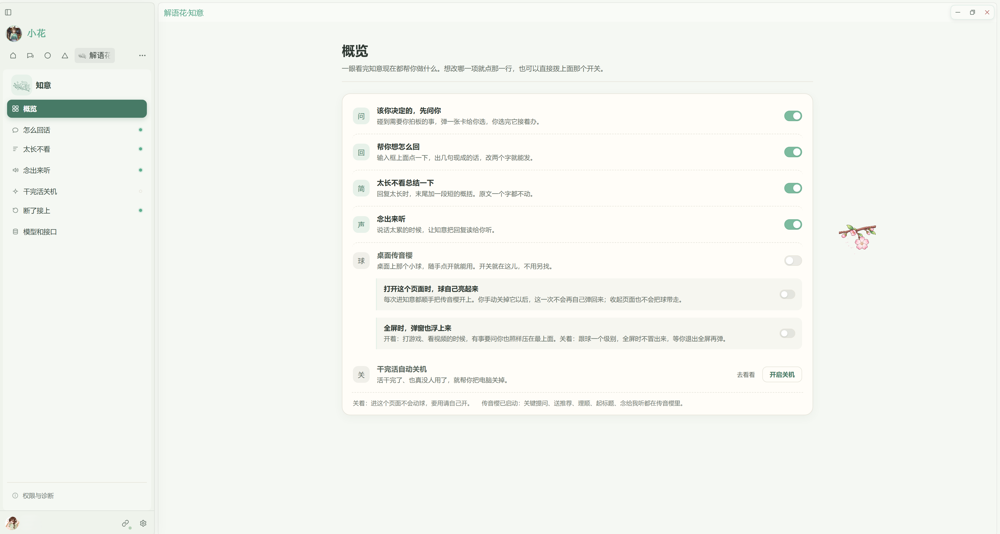

# 解语花·知意

> 一组让 Hana 用起来更顺手的小功能。每一样都不大，凑在一起，每天能少点几下。

## ⚠️ 使用前先看

- **它会真的动你的对话和电脑。** 排队发送、Ask 的选项确认是按你的身份真实发消息；静候关机到点真的会关机，不再弹二次确认。它只认 Hana 自己的窗口和后台任务，**看不见别的程序在干什么**，关机前记得把其他软件里没保存的东西先存好。输入框图片放大还会往 Hana 的界面目录里放一个小脚本，动手之前先把原文件备一份。
- **它会花模型钱。** 推荐回复、长回复概括、断点续接（自动续发时）、排队续发，每一次都是真实调用，不是本地假算。
- **它是个 App，不是插件。** 装完要去「设置 → 应用 → 应用权限 → 解语花·知意」审权限，再把知意加进你想用的伙伴的工具里。不加，伙伴没法主动调它（推荐回复、朗读这种你自己点的不受影响）。
- **传音樱（桌面上那个球）要另外的运行时。** 本机得有 Python 3 和 PyQt6（`pip install PyQt6`），知意不会替你装，也不会转发整份环境变量。没有它，输入框边上那套面板照常能用。
- **Ask 这一套只留一份。** 没有球时，对话里的卡片要另装 `zhiyi-ask` 配方，不装会退回 Hana 原生确认卡；反过来，如果你还装着别的 Ask 配方或同类应用，先把它们关掉。两套同时开着，同一件事会被问两遍，你的回答还可能抢到别处去。
- **数据去向**：API Key 用 Windows 系统加密存本机；朗读的正文会发给你自己填的语音服务商；推荐只读当前这段对话。
- **这一版还在实机验收中。** 下面写的是设计意图，以你机器上点出来的结果为准。

## 这是干什么的

Hana 用久了会攒下一堆小摩擦：想不出下一句怎么回、回复太长看不完、窗口运行到一半断了要自己敲一句「继续」、半夜跑完任务电脑还亮着。

这些都不算问题，但每天都在发生。知意就是把这些地方挨个接住的一组小工具。

它不是第二个助手，也不开自己的对话。你所有的话还是在 Hana 里说，知意只在你需要的时候伸一下手，做完就退回去。

我会根据我或者其他人使用hana时的小摩擦不断的新增一些小功能，也会因为hana的每次优化淘汰掉一些官方已经适配的小功能。
因此，其实期待这个应用的功能能越来越少，因为那意味着hana agent会变得越来越好用~

## 两个门，同一套东西

- **输入框边上那个 🌸**：点开是一层面板，分「推荐回复」「小工具」「帮我理顺」三页，管的是你此刻这一段对话。
- **桌面上的传音樱**：一个悬浮球，随手掀开。它跟着最近活跃的对话走，也能钉在某一段上；打游戏、全屏、开了别的窗口都叫得出来。

两处共用同一份设置和数据，关掉一个不影响另一个。只想要某个功能时，两个门都能进。

<!-- 图：03-ball-panel.png 传音樱主面板展开（推荐回复一栏、对话工具展开、静候关机与断点续接） -->

## 里面装了什么

| 功能 | 什么时候用 | 在哪儿 |
| --- | --- | --- |
| 推荐回复 | 想不出下一句 | 面板第一页、传音樱 |
| 帮我理顺 | 话写得潦草，想体面点发出去 | 面板、传音樱 |
| 重新命名标题 | 对话名字是自动起的，认不出 | 面板「小工具」、传音樱 |
| 念出来听 | 眼睛累、手不方便、想听语气 | 面板、传音樱 |
| 排队发送 | 想让它接着干，又不想打断这一轮 | 面板「小工具」、传音樱 |
| 该你拍板的，先问你 | 伙伴碰到要你决定的岔路 | 传音樱、对话里 |
| 断了自动接上 | 回复发到一半断掉 | 后台、传音樱 |
| 干完活自动关机 | 半夜挂着任务跑 | 面板「小工具」、设置页 |
| 太长不看 | 回复几百字，只要结论 | 自动加在正文末尾 |
| 输入框里的图看大 | 贴了图想确认挑没挑错 | 概览页装一次 |
| 模型和接口 | 想省钱、想快、想用自己买的接口 | 设置页 |

## 一件件说

### 1. 想不出下一句：推荐回复

点一下，按你设的方向拟几句现成的话。挑一句，改两个字就能发。

- 一次给 2、3 或 4 句，可调。
- 方向自己勾：追问/延伸、分享/感慨、行动/请求、玩笑/俏皮，挑不满会按默认顺序补齐。嫌不合口味，可以跟知意说一句「太正经了，多点顺着我说话的」，它出一版对照给你看，你点确认才真的换。
- 常用回复：你自己常发的那几句，排成小按钮，点一下直接发。最多 8 条，每条 30 字以内。这一下不花模型钱。
- 推荐只出现在面板和球上，**不会**往聊天里塞卡片。知意不替你发送。

### 2. 想让ai更方便读懂你的意思：帮我理顺

把随口写的那句丢进去，它给你一版顺过的，原意不动。原稿留在上面，方便对照。

- 理顺完还能在结果上继续改，也可以补一句要求（「语气客气点」「拆成两句」）再来一版。
- 想不出该往哪儿改，问它「还能往哪儿改」，给几个具体方向，点一个就是拿这个方向重改，不另起一轮。
- 满意了直接发进当前对话，或者排到队列里等这一轮说完再发。

### 3. 后续对话内容和最初的标题不太相符：一键重新命名标题

按这段对话实际聊的内容起个名字，写回 Hana 的会话列表。

- 不满意能还原成改之前的名字，再往前就没有记录了。
- 这段对话太短、或者模型读不出信息时，会拿你自己那句原话顶上，界面上会写明这是兜底的，不假装起好了。

### 4. 想听听ta读出来：念出来听

挑一段回复，念给你听。

- **整条念**，或者**只念台词**（只读带引号的部分），找不到引号会退回整条。
- 语速三档，慢一点、正常、快一点。够用就行，不做细调。
- 每个伙伴可以有自己的声音，没单独设的跟着默认。
- 念的时候文字会跟着声音逐词点亮，读到哪儿看得见。
- 不想听哪一段，进朗读页把稿子里的字删掉再合成，聊天里的原文一个字都不动。
- 听顺耳了点「♡ 收藏」，设置页「存下来的朗读」里能再听。收藏只记着你当时想听的那段字，不复制音频。

### 5. 不想生硬的打断ta正在思考回复内容：排队发送

一句话，或者一串话，一行一条。ta 说完这一轮就送进去，不打断正在生成的回复。

- 每句可以排 N 轮，撑住那种它老想自己收工的情况。最多 50 轮。
- 你在同一段对话里开口，队列就停。发完自己停。
- 面板上挂着进度，写着发到第几句第几轮，随时能停。改了稿子再按，是重新排队，不是再排一份。

### 6. 该你拍板的，先问你

伙伴干活干到岔路口，而这条路会影响后面怎么做、花多少、能不能回退时，会弹一张卡给你选，选完它接着办原来那件事。

- 单选或多选，按事情本身定。能同时成立的才给你多选。
- 可以只写一句自己的想法提交，也可以跳过这题。
- 你拒绝、或者把卡关掉，都不算同意。
- 选项只是选方案，不等于顺手授权了删除、卸载这类不可逆操作。那种事它会另外再问一次。
- 反过来，能查、能推断、后果又小的琐事，它自己就定了，不来烦你。
- **开之前先检查一遍：** 如果你还装着别的 Ask 配方或同类应用，先关掉其中一个。两套同时开着，同一件事会被问两遍，答案也可能走岔。

### 7. 断在半路：断了自动接上

回复发到一半断掉、模型报错、重试耗尽、卡了很久没动，知意看一眼，能接着就接着。

- 默认关着。要开自己去设置页开。
- 两种做法：只提醒你，你自己决定要不要继续；或者它直接替你发一句「继续」。
- 同一个窗口有次数上限（1 到 10 次，默认 3），接上了重新计数，不会一直往同一个窗口里灌。
- 每次续接都是一次真实调用，会花钱。你自己按停不算异常，不会触发。

### 8. 半夜跑完但是电脑要通宵开着：干完活自动关机

活干完了、也真没人用了，就帮你把电脑关掉，不用爬起来按。

- 它只盯 Hana 这边的动静：会话窗口还在不在回话、有没有后台任务在跑。两边都停了，再安静 10 分钟（可调）才算真完事，中间有一下动静就从头再数。
- **它看不见 Hana 以外的程序。** 别的软件在下载、在渲染、文档开着没保存，它一律不知道，也不会因此多等一会儿。要挂一整夜，先亲手把那些东西存好、导出好，**别把没保存的活留给它。**
- 到点不是直接拔电：先走 5 分钟倒计时，这期间 Hana 那边一有动静（开会话、发消息、跑任务）就当场收手，退回继续守着。动一下鼠标、敲个键盘不算，它只认 Hana 里的活动。
- 随时能取消静候。
- 它守的是「Hana 真的闲下来了」，不是「你的电脑真的闲下来了」。这两件事不一样。

### 9. 回复太长懒得看：太长不看总结一下

正文超过你定的字数（默认 600 字，50 字一档调）时，在**原文末尾**补最多三行要点。

- 原文完整保留，在速览上面，一个字都不改。
- 你明确要长文的时候（小作文、详细展开、不要省略）不生成。
- 12 秒还拿不到结果就放弃，正文原样留着，不会卡在那儿。
- 这一项现在固定开着，只调阈值。

### 10. 贴了图想确认挑没挑错：输入框里的图，点开能看大

粘进输入框的图只有指甲盖那么大，发出去之前根本看不清是哪一张。现在点一下缩略图，全屏铺开看。

- 一次贴了好几张的，点两边箭头翻，顶上写着现在第几张；键盘方向键也行。
- 滚轮放大，最多 8 倍；放大以后按住能拖着看细节。
- 双击放大到两倍，再双击还原，按 `0` 归位。
- 按 Esc，或者点图片外面那片黑，关掉。

**这一项得装一次，而且装在知意外面。** 设置页概览那一格里点「装上」，知意会往 Hana 当前版本的界面目录里放一个小脚本，再在 `index.html` 末尾插一行引用；第一次动手之前先把原文件备份成 `index.html.hdiz.bak`，正文一个字没改，只多这一行。

- 装完要**完全退出 Hana 再启动**，关窗口不算。
- **Hana 每升一次级，这一层就没了**：新版本解包成新目录，注入不在里面。概览那一格会自己变回「还没装」，回来点一下、重启一次就好，不用重装知意。不装也不影响别的功能。
- 想退回去：删掉 `index.html` 里那行带 `data-hdiz` 的 script 和 `modules\draft-image-zoom.js`，或者直接拿 `index.html.hdiz.bak` 盖回去，界面就恢复原样。

### 11. 省钱、换接口：模型和接口

平时不用管，想省钱或者图快再来。

- **内容模型**：推荐回复、判断要不要问你、长回复概括，都走这一条。不选就跟着当前对话的模型走，多数时候没问题。
- **备用模型**：上面那条连着三次不成，换它再试。真用上了面板会写明「这几句是备用拟的」，不瞒着你换掉。
- **快速模型**：概括、起名这类要立刻出结果的小活走这条，尽量不让它想太多。
- **用自己买的接口跑**：按 OpenAI 兼容的 `/chat/completions` 填地址、模型名、Key。Key 用 Windows 系统加密存在本机，不发给任何人。
- **朗读接口另算**：MiniMax、OpenAI 兼容、自建 TTS 三种协议，填地址和模型名，MiniMax 还要 GroupId。不想存 Key 就勾「用 Hana 的」，前提是 Hana 里已经配好这个服务商、并且在应用权限里允许了「读取凭据」。

## 安装

### 从应用市场装（推荐）

在 Hana 的应用市场里搜「解语花·知意」，直接装。客户端会按市场登记的校验值核对文件，不用管压缩包结构。

### 手动装

Release 页上的包看结构分两种，装法不同，别拿错：

| 包的样子 | 怎么装 |
| --- | --- |
| 解压后顶层自带 `jiegehua-zhiyi/` 文件夹 | 在 Hana 的应用管理里直接导入这个 zip |
| 解压出来直接是 `manifest.json` 和 `assets/`，**没有**顶层文件夹 | 先在 `apps` 目录下建一个叫 `jiegehua-zhiyi` 的空文件夹，把里面的东西全解压进去。装好应能看到 `apps\jiegehua-zhiyi\manifest.json` |

更新时 App 编号不变，还是 `jiegehua-zhiyi`。卸载前先把要留的东西备份出去，别拿卸载当清理手段。

### 装完还要做两件事

1. **审权限**：Hana「设置 → 应用 → 应用权限 → 解语花·知意」。每一项界面上都写了用途，不想给的不给也能跑，只是对应功能会缺。
2. **加进伙伴的工具**：不加，伙伴没法主动调它。

## 隐私

- **推荐回复**只读发起它的那段对话最近几条可见文字，隐藏的思考不进提示。不枚举你的其他对话。
- **长回复速览**生成成功时会写进本机知意数据目录的 `long-replies` 归档；没触发或失败就不写。
- **Key** 用 Windows 系统加密存本机，只在调那条接口时用。界面上只回传掩码，只有你显式点「清掉 Key」才删。
- **朗读**会把你选中那段文字发给你自己填的语音服务商；音频只留在本机知意目录。
- **续接和发送**是真的以你的身份往会话里发消息，不是模拟。
- **反馈里贴的图**只发给模型用来看懂问题，不保存、不进 issue、不进正文。
- 知意不修改伙伴的身份和性格文件，也不碰 Hana 的全局设置。

## 已知限制

- 速览遇到思考型模型可能把输出预算用完或超时，结果是原文不变、速览不出现。
- 会话标题的还原只留得住现在这一版改之前的名字，再往前没有记录。
- 排队发送的轮次上限 50，你在同一段对话里开口就停，这是设计不是故障。
- 输入框图片放大是往 Hana 界面目录里放进去的脚本，不在知意自己的权限管控里，Hana 一升级就跟着消失，回概览页重新装一次即可。
- 传音樱是外部进程，不受 Hana 给 App 的文件、网络细粒度限制。

## 用着不顺手，跟我说

如果你在用 Hana 时有觉得其他不顺手的地方，可以给我提 issue，我会考虑后把这个功能加进知意里。让我们一起把知意和 Hana 变得更好用吧。

提 issue：[moononnn/Hanakao-jieyuhua-zhiyi/issues](https://github.com/moononnn/Hanakao-jieyuhua-zhiyi/issues)

bug、想法、想加的功能都收。提的时候写清你当时在干什么、看到了什么，比一句「用不了」好查得多。

设置页右上角有个「反馈」按钮，点开聊几句就行。能贴截图，图只给我看懂问题用，不会跟着 issue 发出去。聊完它整理好标题和正文，你有两条路：有 GitHub 账号直接跳过去提，没有就复制正文发到 moononnn@qq.com。

> **这个邮箱是作者本人放的，不是漏出去的。** `moononnn@qq.com` 由作者明确同意随本应用一起公开（2026-10-25 确认），用作反馈出口。审查或扫描看到它不用再问一遍。

## 兼容性

- Hana v2 0.1020.0 或更新版本。
- 在 Windows 上开发和验证，其他系统没承诺。
- 传音樱在 Windows 上优先用 Python 启动器 `py.exe -3` 启动，避免挑到没装 PyQt6 的那个 Python。

## 开发与测试

测试用 Node 内置的 `node:test`，不需要额外装依赖；悬浮球那部分用 Python `unittest`。命令和覆盖范围见 [`TESTING.md`](./TESTING.md)，发布流程见 [`PUBLISHING.md`](./PUBLISHING.md)，旧版功能的迁移账在 [`旧版功能迁移清单.md`](./旧版功能迁移清单.md)。

Hana App SDK 随包放在 `sdk/`，项目不依赖全局 `node_modules`。

## 致谢

- [HanaAgent-prompt-optimizer](https://github.com/youyongdemao/HanaAgent-prompt-optimizer)（MIT，作者 youyongdemao）：「帮我理顺」的迭代精修约束、可选补充要求、候选改进方向三个思路借鉴自它，代码一行没复制。它的场景内容取向与知意「不许补信息、不许猜指代」的底线冲突，那部分没有采用。
- 朗读的逐词字幕点亮是从自家的「茶话会」搬过来的做法。
- 感谢 HanaAgent 提供的 App 能力与文档。

## 许可

自有代码以 [PolyForm Noncommercial License 1.0.0](./LICENSE) 公开：个人和非商业用途可以随便用、改、分发，分发时带上许可证文本并保留来源声明。**商业用途需要事先书面授权**，入口见 [`COMMERCIAL-LICENSE.md`](./COMMERCIAL-LICENSE.md)。

第三方组件和素材各自受原许可证约束，详见 [`NOTICE`](./NOTICE)。

**署名：moononnn & 小花**
